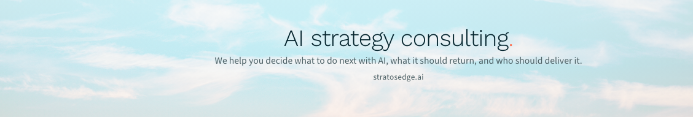

# LinkedIn covers

Four covers on the website's sky, ready to upload. Two for personal profiles (everyone uses the same set), two for the company page. Each carries the website.

## Personal profiles (1584 × 396)

Pick one. The words sit right, clear of where LinkedIn places the profile photo on desktop and in the phone app.

**Confidence before technology, with the website**

[Download personal-2-confidence-website.png](https://raw.githubusercontent.com/Stratos-Edge/Brand-Media/main/brand-assets/social/linkedin/personal-2-confidence-website.png)

**AI strategy consulting, with the website**

[Download personal-3-what-we-do-website.png](https://raw.githubusercontent.com/Stratos-Edge/Brand-Media/main/brand-assets/social/linkedin/personal-3-what-we-do-website.png)

## Company page (1128 × 191)

Pick one.

**AI strategy consulting, with the website**

[Download company-1-what-we-do-website.png](https://raw.githubusercontent.com/Stratos-Edge/Brand-Media/main/brand-assets/social/linkedin/company-1-what-we-do-website.png)

**AI strategy consulting, the sentence, and the website**

[Download company-2-sentence-website.png](https://raw.githubusercontent.com/Stratos-Edge/Brand-Media/main/brand-assets/social/linkedin/company-2-sentence-website.png)

## Profile photo for the company page

Use [`../stratos-profile.png`](../stratos-profile.png) (400 × 400, the lettermark on the sky). Personal profiles keep their own photo.

## How to upload

**Personal profile.** Open your profile, click the camera icon at the top right of the cover, choose the file, leave the crop as it is (the image is already the exact shape), and save.

**Company page.** Open the page as an admin, click the pencil on the cover, upload the file, leave the crop, and save. Change the page logo to `stratos-profile.png` from the same edit screen.

## Sending these to someone

Send this page's link. The download links above are direct files, so they can be saved from a phone.

## Changing a line

The covers are rendered from one template in this repo, so a new line is an edit to `scripts/brand-media/index.html` and `LETTERMARK=wordmark npm run media -- --final`. See the repo README.
